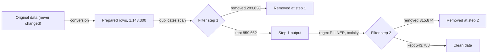
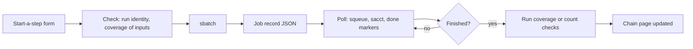

# UI design analysis: running the pipeline and tracking every row

Written on 12 Oct 2026, after the Phase 8 full run. Everything in Part 1 was
checked against the real data in `output/prepared/tools_team/` and
`output/tool_team_chain/`, not only against the code.

## The short version

- **Tracking is complete.** For every one of the 1,143,300 rows we can say
  where it came from, what each scanner found in it, whether it was removed
  (and why, at which step), or where it sits in the clean data. I checked this
  on real rows from both ends, and it holds.
- **What's missing is not tracking, it's *finding* and *running*.** Today you
  can follow a row if you already know where it is. You can't yet list "all
  rows NER removed from `rl_mix/train`" page by page, and the UI can only start
  conversions, not scans, filters, traces or row status.
- **The UI should grow out of the existing validator app** (FastAPI + React,
  on localhost). It already does conversions, jobs, runs and "Show original".
  We add four things to it: a chain view, a row view (the full story of one
  row), a removed-rows browser, and a jobs page that can start every step.
- **A few small backend pieces come first** (Part 4): a job record for every
  kind of job, job scripts for the trace and row status, an index of removed
  rows, a way to go from an Original row to its Prepared row, and letting the
  validator open filter runs.

---

## Part 1: Is the tracking complete?

### How the data moves



Each arrow leaves a record behind:

| Link | The record that proves it |
|---|---|
| Original row to Prepared row | The origin note inside every Prepared row (`metadata._origin`): the Original file, the row or line, and a fingerprint |
| Prepared row to step 1 to step 2 | Each filter run's line map: for every kept line, the line it came from and its fingerprint |
| Why a row was removed | Each filter run's `removed_rows.ndjson`: the parent line, the reasons, the findings, and the whole row |
| What each scanner found | The scanners' own results files, each finding with its file, line and fingerprint |
| Everything about one row, in one place | The row status (`row_status/`): one entry for every Prepared row, readable one row at a time |
| Every finding still points at the right row | The trace (`trace/`): 9,350,260 findings, all `unchanged` |

### What I checked on the real data

I read all 1,143,300 row status entries (46 seconds, 220 MB of memory), and
ran "Show original" on real rows.

| Question | Answer | What I saw |
|---|---|---|
| Does every Prepared row have exactly one status entry? | **Yes** | 1,143,300 entries for 1,143,300 rows |
| Does every row know its Original row? | **Yes** | 0 rows without an origin note |
| From a clean row, can I get back to the Original? | **Yes** | `mopd_mix/test` line 1: kept at both steps, Original row 0, "Show original" says `unchanged` |
| From a removed row, can I see why and get back to the Original? | **Yes** | Line 6: removed at step 2 by NER, Original row 5, `unchanged` |
| From a removed duplicate, can I find the copy that was kept? | **Yes** | Line 199: removed at step 1 as a duplicate of line 173, Original row 198, `unchanged` |
| From an Original row, can I find its Prepared row? | **Partly** | There's no stored index. But in all 65 runs the Original rows appear in order (0, 1, 2, ...) with no gaps, so the Prepared row can be worked out and then confirmed by its fingerprint. See gap 2. |
| Can I see rows the conversion skipped? | **Yes** (format and UI exist) | No rows were skipped in this data, so it hasn't been used on real tool team data yet |
| Can I list removed rows by reason, a page at a time? | **No** | See gap 1 |
| Can I highlight what a scanner found? | **Mostly** | NER: message and character positions. Toxicity: which message. Regex PII: the matched text only, no positions (see gap 6) |
| Can I get counts per step for a dataset cheaply? | **Yes** | From the `summary.json` files alone, no data files needed |
| How fast is "Show original"? | **1 to 5 seconds** | 4.9 s for row 236,599 of the largest Parquet file, 1.4 s for a smaller dataset |

### Things the numbers tell us the UI must handle

- **A duplicate's kept copy may itself be gone.** Of the 283,638 duplicates
  removed at step 1, **121,976** point to a kept copy that step 2 then removed
  (usually by NER). So "removed as a duplicate of X" isn't the whole story.
  The UI should also say what happened to X, and the backend already has the
  answer (X's own row status).
- **Most duplicates cross datasets.** 216,910 of them point to a row in a
  *different* dataset. The duplicate view must open rows from any dataset.
- **Some rows were never looked at by later scanners.** 850,914 "not scanned
  because it was removed earlier" marks, and 41 rows with no text for the
  duplicates scanner. The UI must say "not scanned", never "clean", for these.
- **Some datasets end up empty.** `sft_mix/xlam_irrelevance_v2` has no rows
  left after step 1, and `sft_mix/xlam_v2` keeps 3 of 35,278. The UI should
  show that clearly instead of an empty table.

### Gaps that matter for the UI

None of these is a hole in the tracking. They're about speed, listing and
running.

1. **No way to page through removed rows by reason.** `removed_rows.ndjson`
   for `rl_mix/train` at step 2 is 1.45 GB for 82,830 rows, with no index. The
   row status can be read one row at a time, but only if you already know the
   Prepared location. Needed: a small index of removed rows (run, step, reason,
   Prepared location, and where the entry starts) that the UI can filter and
   page.
2. **No direct Original-to-Prepared lookup.** It can be worked out today,
   because the conversion keeps rows in order and none were skipped: with
   1,000 rows per file, Original row N is in Prepared file number N ÷ 1,000,
   at line (N mod 1,000) + 1. That only holds for unshuffled runs with no
   skipped rows. Needed: one function that does this when it's safe, confirms
   it by fingerprint, and otherwise searches.
3. **The validator can't open filter runs.** "Open run" only accepts Prepared
   runs. Its runs list only looks under `output/prepared`, and the chain lives
   in `output/tool_team_chain`.
4. **The UI can only start conversions.** Every other step is a different
   shell script, or a raw `sbatch`. Nothing records which job made which
   folder, or which steps belong to one chain.
5. **No job scripts for the trace and the row status.** They were run with
   `sbatch --wrap`.
6. **Regex PII findings have no positions.** To highlight one, the UI has to
   search for the matched text inside the row. That's fine, but it can match
   more than once.
7. **Only conversion writes live progress** (`progress.json`). For the other
   steps, the UI can only see "running" (from SLURM) and "finished" (from the
   `_SUCCESS` files). The NER and toxicity scans do have per-piece markers,
   which give a rough percentage.
8. **No chain-wide totals of removed rows per reason.** They're per dataset in
   the row status summary; the UI has to add them up.

**Verdict:** the data side is ready. The UI work needs gaps 1 to 5 closed
first, and gaps 6 to 8 handled inside the UI.

---

## Part 2: What the UI has to let you do

In plain words, the jobs the UI does for you:

1. **Run the pipeline:** convert data, start each scan, filter, check, trace
   and build the row status. Always pick from finished runs, and see the cost
   (CPUs, GPUs, time) before submitting.
2. **Watch the jobs:** what's queued, running, finished or failed, and why;
   the log; how far along it is.
3. **See the results:** for each step, the counts, the coverage verdict, what
   each scanner found and what each filter removed.
4. **Follow any row, in both directions:**
   - from an Original row to its Prepared row, to clean or removed;
   - from a clean row or a removed row back to its Prepared and Original row;
   - from a scanner finding to the row it's in;
   - from a duplicate to the copy that was kept, and what happened to that copy.
5. **Browse what was removed:** by dataset, step, reason, NER label, regex
   category or toxicity verdict, with the reason highlighted in the row.
6. **Tune the rules and re-run the filter:** see how many rows each rule
   would remove before you run it.
7. **Get the clean data:** where it is, how many rows per dataset, and that it
   passed every check.

---

## Part 3: How the UI should look

### Keep one app: grow the validator

The validator already has the hard parts: a FastAPI backend that imports the
same `modelsafety` code as the batch tools, SLURM job submission with
resource checks, the runs list, and "Show original". Building a second app
would mean two job systems and two lookups that could disagree. So the plan
is to add pages to the validator.

### The pages

```text
+--------------------------------------------------------------------------------+
|  Model Safety                                                                  |
|  [Home] [Sources] [Chains] [Rows] [Removed] [Jobs]                 health: OK  |
+--------------------------------------------------------------------------------+
```

| Page | What it's for | Exists today? |
|---|---|---|
| **Home** | The latest chains, running jobs, anything that failed | No |
| **Sources** | Pick Original data, preview the mapping, start conversions | Yes (today's Inspect and Review tabs) |
| **Chains** | One page per chain: the steps, counts, checks, and buttons to run the next step | No |
| **Rows** | The story of one row, from Original to clean or removed | Partly ("Show original" only) |
| **Removed** | Browse and filter removed rows | No |
| **Jobs** | Every job of every kind, with status and logs; start new steps | Partly (conversions only) |

The screens below are sketches of the layout. Where they show running jobs
or sample row text, those are made up for the picture. The chain counts are
real.

### Home

```text
+--------------------------------------------------------------------------------+
| Running now                                                                    |
|   NER scan   tool_team_chain / step 2      8 GPUs   612 of 1,107 pieces  55%   |
|   Toxicity   tool_team_chain / step 2      8 GPUs   shard 5 of 8 finished      |
|                                                                                |
| Chains                                                                         |
|   tool_team_chain   1,143,300 -> 859,662 -> 543,788   all checks pass   12 Oct  |
|   pilot_chain           4,938 ->   4,886 ->   2,643   all checks pass    9 Oct  |
|                                                                                |
| Needs attention                                                                |
|   (nothing)                                                                    |
+--------------------------------------------------------------------------------+
```

### Chains: the main page

One chain on one screen, drawn the way the data flows. Every box is
clickable.

```text
+--------------------------------------------------------------------------------+
| Chain: tool_team_chain                                     [Run next step v]   |
|                                                                                |
|  Prepared          Step 1               Step 2                    Clean        |
|  1,143,300  --->  Duplicates  --->     Regex PII  -+              543,788      |
|  65 runs          removed 283,638      NER        -+-> removed    47.6%        |
|  [checks OK]      kept 859,662         Toxicity   -+   315,874                 |
|                   [coverage OK]        [coverage OK]                           |
|                                                                                |
|  Trace: 9,350,260 findings, all unchanged       Row status: built, checks OK  |
+--------------------------------------------------------------------------------+
| Datasets                         Prepared   Step 1 kept   Clean    Removed by  |
|   rl_mix/train                    236,641      164,841    82,011   dup/ner/... |
|   sft_mix/xlam_v2                  35,278            4         3   dup 35,274  |
|   sft_mix/xlam_irrelevance_v2       1,697            0         0   all dup     |
|   ...                                                    [search] [sort]       |
+--------------------------------------------------------------------------------+
```

- **Clicking a step** opens its results: the coverage verdict in plain words,
  the scanner's counts (for NER, spans by label; for toxicity, the verdicts;
  for regex PII, the categories), and the rules the filter used.
- **Clicking a dataset** opens the same funnel for that dataset only, plus
  "browse its removed rows" and "browse its clean rows".
- **"Run next step"** only offers steps whose inputs are finished. Each step
  is described in Part 4.

The numbers are the real ones from this run. Every number on this page comes
from `summary.json` files (Prepared runs, filter runs, row status) and the
coverage JSON, so the page loads fast without reading any data files.

### Rows: the story of one row

This is the page you asked for: "when I see a removed row, where did it come
from?" Any other page that shows a row links here.

```text
+--------------------------------------------------------------------------------+
| Row: mopd_mix/test, Prepared line 6                       [Copy link]          |
|                                                                                |
|  Original  ---->  Prepared  ---->  Step 1  ---->  Step 2  ---->  REMOVED       |
|  row 5            line 6           kept           removed by NER               |
|  [Show original]                   (line 6)       2 findings                   |
|                                                                                |
+----------------------------------+---------------------------------------------+
| The row                          | Findings                                    |
|  system: You are a booking ...   |  Step 1, duplicates: none                   |
|  user: My card is [4111 ...] <-  |  Step 2, NER: customer_id (0.75),           |
|  assistant: ...                  |    medical_record_number (1.00)  <- removed |
|                                  |  Step 2, regex PII: none                    |
|  (highlights are clickable)      |  Step 2, toxicity: none                     |
+----------------------------------+---------------------------------------------+
| Original file: .../mopd_mixv4_0907/test.parquet, row 5                         |
| Still the same as when it was converted: yes (checked by fingerprint)          |
+--------------------------------------------------------------------------------+
```

- **The timeline at the top** is the row's whole journey. Each step says
  kept, removed (with the reason) or "not reached" (removed earlier). If the
  row is clean, the last box says where it is in the clean data.
- **The row** shows the conversation with each finding highlighted: NER by
  message and character positions, toxicity by message, regex PII by finding
  the matched text.
- **Findings** lists every scanner's findings, step by step. It marks the
  ones that caused the removal, and separates "found nothing" from "not
  scanned".
- **For a duplicate,** a second panel shows the kept copy side by side, and
  says what happened to that copy. In 121,976 cases the copy was removed
  later, and the page has to say so.
- **"Show original"** opens the Original row and says whether it's still the
  same. It takes 1 to 5 seconds, so it gets a loading state and is cached.

You can get to this page in four ways:

| Start from | How |
|---|---|
| A Prepared row | Dataset, file and line. Read straight from the row status. |
| A clean row | Clean dataset, file and line. Walk the two line maps back to the Prepared row. |
| An Original row | Original file and row number. Needs the Original-to-Prepared lookup (gap 2). |
| A finding or a removed row | Any link on the Removed page or a step's results page |

### Removed: browse what was taken out

```text
+--------------------------------------------------------------------------------+
| Removed rows                                                                   |
| Dataset [rl_mix/train v]  Step [2 v]  Reason [NER v]  Label [email v]          |
|                                                                                |
| 12,431 rows                                                   page 1 of 249    |
|  Prepared line   Reason                 What was found         Original        |
|  data_000004:6   NER                    email x2               row 4005 [open] |
|  data_000004:14  NER, regex PII         email, emails          row 4013 [open] |
|  data_000009:31  NER                    email                  row 9030 [open] |
|  ...                       (an illustration of the layout, not real rows)      |
+--------------------------------------------------------------------------------+
```

- **Filters:** dataset, step, reason (duplicate, NER, regex PII, toxicity
  Unsafe, Controversial, guard error), and within a reason the NER label,
  regex category or toxicity verdict.
- **Each line** opens the row page.
- **Paging** needs the removed-rows index (gap 1). Without it, each page would
  mean reading a 1.45 GB file.
- **The same page,** with "kept" selected instead of "removed", browses the
  clean data.

### Jobs: everything running, and starting new steps

```text
+--------------------------------------------------------------------------------+
| Jobs                                             [Start a step v]              |
|  Kind        Chain / input          Started   Status        Progress   Log     |
|  NER         tool_team_chain/step2  09 Oct    finished      1107/1107  [view]  |
|  Toxicity    tool_team_chain/step2  09 Oct    finished      8/8        [view]  |
|  Filter      tool_team_chain/step2  12 Oct    finished      65/65      [view]  |
|  Conversion  65 datasets            09 Oct    finished      65/65      [view]  |
+--------------------------------------------------------------------------------+
```

**Starting a step** is the same short form for every kind of job:

1. **Input.** Pick a finished run folder. The form shows what the scan will
   read and what it will skip, from the run finder.
2. **Settings.** Only the ones that matter: rules for a filter, text settings
   for duplicates, nothing for NER.
3. **Cost.** CPUs, memory, time limit and GPUs, with the defaults filled in,
   and a plain warning for GPU jobs (for example: "8 GPUs, up to 7 days").
4. **Check.** Before submitting: the run identity (is that folder already
   used for something else?), and that the inputs passed coverage.
5. **Submit.** The job appears in the list and on its chain's page.

### Tuning the rules before re-running the filter

On step 2's page, a small panel shows how many rows each choice would remove,
before anything runs. These are the numbers worked out after this run:

| NER labels ignored | Rows removed by NER or regex PII |
|---|---|
| none (what was used) | 314,866 |
| first_name, last_name | 239,324 |
| + user_name | 219,970 |
| + customer_id, url | 186,771 |
| + postcode | 167,084 |

Working these out by reading NER's 6.4 million spans took about a minute. So
the backend should save a small table per chain, listing for each row which
labels and categories hit it. The panel then answers instantly. After you
pick, "Re-run filter step 2" starts a 3-minute CPU job into a new folder; the
old result stays.

---

## Part 4: What the backend needs

### Where each page gets its data

| Page | Reads | Exists? |
|---|---|---|
| Home, Chains | Prepared, filter and row status `summary.json`; coverage JSON; trace `summary.json`; job records | Yes, except job records |
| Step results | Each scanner's `summary.json`; coverage JSON; filter `summary.json` | Yes |
| Rows | `read_row()` from the row status; the line maps; `lookup()` for Original | Yes |
| Rows, from an Original row | Original-to-Prepared lookup | **No** (gap 2) |
| Removed | Removed-rows index, then `read_row()` | **No** (gap 1) |
| Jobs | Job records + SLURM (`squeue`, `sacct`) + done markers | Partly (conversion only) |
| Rule tuning | Per-row labels and categories table | **No** |

### Backend pieces to add (before the UI)

| # | What | Why | Size |
|---|---|---|---|
| B1 | **One job record for every kind of job.** A JSON file per job: kind, chain, input, output, settings, SLURM job IDs, submitted time. The conversion batches in `output/prepared/_jobs/` already work this way; widen it. | The Jobs page and chain pages need to know which job made which folder | Medium |
| B2 | **One "start a step" function per kind,** called by the backend, never interactive. Each builds the same command the wrapper would and submits it. | Today it's six different scripts with different flag names, and some prompt | Medium |
| B3 | **Job scripts for the trace and the row status,** like `filter_rows.sbatch` | They need 256G and can't run inside the web server | Small |
| B4 | **Removed-rows index:** per run and step, one line per removed row with its reasons, labels, categories, Prepared location and offset. Built by the row status step (it already reads everything). | Paging the Removed page | Small to medium |
| B5 | **Original-to-Prepared lookup:** work it out when the run is unshuffled with no skipped rows, confirm by fingerprint, otherwise search | "Start from an Original row" | Small |
| B6 | **Let the validator open filter runs** and read more than one root (`output/prepared` and the chain folders) | The chain lives outside `output/prepared` | Small |
| B7 | **Chain records:** name a chain and list its folders. Most of it can be read back from the last filter step's `run_identity.json`, the way the row status already does. | The Chains page | Small |
| B8 | **Per-row labels table** for rule tuning | Instant "what if" counts | Small |
| B9 | **Progress for each kind of job,** from what already exists: `progress.json` (conversion), `units/*/_SUCCESS` (NER), shard markers (toxicity), `_SUCCESS` per stage (regex PII) or per run (filter) | Progress bars | Small |

### How a job is followed



### Safety rules the UI keeps

- **Never change Original data,** and never write into a finished run.
- **Every new step writes a new folder.** "Re-run" means a new folder; the old
  one stays until you delete it.
- **Deleting is a separate, explicit action.** Show the exact paths and sizes
  and ask for a typed confirmation, as `jobs.delete_folders` already does for
  conversions.
- **GPU jobs show their cost** and need one more confirmation.
- **The app stays on localhost** (`127.0.0.1`) with no login, as today. If
  other people will use it, it needs a login and a list of folders it may
  read, because today it can read any path.
- **Read only from files.** No database, and nothing the batch tools can't
  also read.

---

## Part 5: The order to build it in

Read-only pages first, because they're safe and they prove the data is easy to
show. Starting jobs comes last.

| Phase | What | Needs | Done when |
|---|---|---|---|
| **U0** | Backend pieces B3 to B7 | none | The removed-rows index and Original lookup work on `tool_team_chain`; the validator opens a filter run |
| **U1** | Chains page and step results (read only) | U0 | `tool_team_chain` and `pilot_chain` show the right counts and checks for every step and dataset |
| **U2** | Rows page: the timeline, highlights, findings, Show original, the duplicate panel | U0 | The three test rows from Part 1 (kept, removed by NER, duplicate) look right, and a duplicate whose copy was removed later says so |
| **U3** | Removed page (and browsing clean rows) | U0 (B4) | Filter `rl_mix/train` by step 2, NER, email, and page through without delay |
| **U4** | Jobs page showing every kind of job (read only) | B1, B9 | The Phase 8 jobs appear with the right status and logs |
| **U5** | Starting steps from the UI: CPU steps first (filter, coverage, trace, row status, duplicates, regex PII), then GPU steps (NER, toxicity) | B1, B2 | A new chain on the pilot data is run entirely from the UI |
| **U6** | Rule tuning, and the clean data page | B8 | The "what if" numbers match the table in Part 3, and a re-run filter step appears as a new folder |

---

## Part 6: Decisions for you

1. **Grow the validator, or start a new app?** Recommended: grow the
   validator. It already has jobs, runs and lookups that use the same code as
   the batch tools.
2. **Who will use it?** Just you on the cluster (keep localhost, no login), or
   a team (add a login and a list of allowed folders).
3. **Should the UI start GPU jobs?** Recommended: yes, but only after U1 to U4
   work, and always with a cost screen.
4. **Where do chains live?** Today it's `output/tool_team_chain/`, outside
   `output/prepared/`. Recommended: keep chains in their own folders, and let
   the UI read a short list of roots.
5. **Where do the removed-rows index and the labels table go?** Recommended:
   inside the row status folder, built by the same job, so they always match
   it.
6. **Do you want the "what if" panel in the first version?** It's the most
   useful tool for choosing rules, but it isn't needed to follow rows.

---

## Appendix: where each answer lives on disk

| Question | File |
|---|---|
| Which Original row is this? | Prepared row, `metadata._origin` |
| Is the Original row still the same? | `modelsafety/trace/original.py` `lookup()` |
| What happened to this Prepared row? | `row_status/<run>/rows/<file>.ndjson`, read with `row_status_read.py` `read_row()` |
| Where did this clean row come from? | `filter_step2/<run>/line_map/...`, then `filter_step1/<run>/line_map/...` |
| Why was this row removed? | `filter_step<N>/<run>/removed_rows.ndjson` (also in the row status) |
| Which copy did this duplicate keep? | `scans/step1_dedup/dedup_results.jsonl` (also in the row status) |
| Did every scan read everything? | `coverage/step1_dedup.json`, `coverage/step2.json` |
| Does every finding still match its row? | `trace/summary.json` |
| Counts for a dataset at each step | `summary.json` of the Prepared run and of each filter run |
| Counts for the whole chain | `row_status/summary.json` |
| How a conversion is going | `progress.json` in the run folder |
| How a scan is going | NER `units/*/_SUCCESS`; toxicity shard `_DETOXIFY_SUCCESS` and `_SUCCESS`; regex PII `stage*/_SUCCESS`; duplicates `_SUCCESS` |
