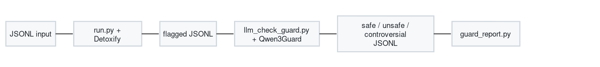

# Toxicity scan

Toxicity screening for JSONL datasets, in two stages plus an optional third (a written policy judge, see [Toxicity policies](#toxicity-policies)). Runs **independently** of the synth-data-gen pipelines: point it at any JSONL file or directory (pipeline output, seeds, benchmarks).

## Pipeline



| Stage | Script | Purpose |
|-------|--------|---------|
| 1 — fast screen | `run.py` | Detoxify multilingual model; flags rows above a score threshold |
| 2 — guard verify | `llm_check_guard.py` | Qwen3Guard via an OpenAI-compatible endpoint (vLLM) |
| 3 — policy judge (optional) | `policy_judge.py` | Granite Guardian 4.1 8B (vLLM) re-judges what Qwen3Guard rated Unsafe or Controversial against a written policy |
| Report | `guard_report.py` | Summarize safety labels by role (user / assistant) |

Supporting library: `detoxify.py` (vendored Detoxify wrapper).

## Input format

JSONL rows with either:

- `"text"`: a plain string to scan, or
- `"messages"`: chat array — stage 1 emits one candidate row **per message** as `"role: content"`.

This matches pipeline outputs (`messages`, `metadata`, `pipeline_info`, …) and seed/benchmark JSONL from `prepare_benchmark_messages.py`.

## Output format

**Stage 1** (`run.py`) writes a slim intermediate JSONL:

```json
{"conversation": [...], "text": "assistant: ...", "toxicity": 0.73}
```

**Stage 2** (`llm_check_guard.py`) reads stage-1 rows, adds a `guard` block, and writes the **full input record** plus annotations:

```json
{
  "conversation": [...],
  "text": "assistant: ...",
  "toxicity": 0.73,
  "guard": {
    "safety": "Unsafe",
    "categories": ["Sexual Content or Sexual Acts"],
    "flagged_role": "assistant",
    "flagged_index": 2,
    "raw": "..."
  }
}
```

Outputs land in `{output_dir}/all.jsonl`, `safe.jsonl`, `unsafe.jsonl`, `controversial.jsonl`.

**Stage 3** (`policy_judge.py`) adds a `policy` block to every record of `all.jsonl` and replaces that file (the other three are Qwen3Guard's own buckets and are not changed):

```json
{"policy": {"skipped": true}}
{"policy": {"decision": "KEEP_GENERAL", "score": "no", "parse_error": null, "error": null,
            "raw": "...", "truncated": false, "model": "ibm-granite/granite-guardian-4.1-8b",
            "policy_sha256": "..."}}
```

`skipped` marks a message Qwen3Guard rated Safe, or gave no usable verdict. For the rest, `NOT_GENERAL` is the policy saying yes (unsuitable), `KEEP_GENERAL` the policy saying no, and `REVIEW` no usable answer (the request failed, or the reply had no yes or no).

**Column retention:** stage 2 preserves every field already on the input record and only adds `guard`. Stage 1 currently rewrites rows into the slim `{conversation, text, toxicity}` shape — when wiring this into pipeline outputs, stage 1 should be updated to pass through all source columns unchanged and only append toxicity fields. That is the target contract for both pre- and post-generation scans.

## When to run

| Timing | Typical input | Notes |
|--------|---------------|-------|
| **Before generation** | Seed JSONL (`text` or early `messages`) | Filter or flag toxic seeds before synth |
| **After generation** | Pipeline output JSONL | QA gate on generated `messages` |

Both scans are offline batch jobs — no coupling to `launchers/slurm/run_with_slurm.sh`.

## Install

```bash
cd modelsafety/data_screening/toxicity
python3 -m venv .venv && source .venv/bin/activate
pip install -r requirements.txt
```

Stage 2 additionally needs a running Qwen3Guard endpoint (same vLLM pattern as the main pipelines).

## Usage

### SLURM — stages 1 + 2 with vLLM (recommended)

Default QA test paths:

```bash
cd /path/to/qvac-model-safety
sbatch launchers/slurm/run_toxicity_scan.sbatch
```

Custom input/output:

```bash
sbatch --export=ALL,TOX_INPUT=/path/to/data.jsonl,TOX_RUN_DIR=/path/to/toxicity_out \
  launchers/slurm/run_toxicity_scan.sbatch
```

The wrapper runs Detoxify stage 1, starts Qwen3Guard with vLLM from the enroot
SquashFS image, waits for the `/health` endpoint, runs stage 2, writes a guard
report, and stops vLLM on exit.

Default outputs under `TOX_RUN_DIR`:

```text
flagged.jsonl                  # stage-1 Detoxify hits
guard_results/all.jsonl         # all stage-2 guard results
guard_results/safe.jsonl
guard_results/unsafe.jsonl
guard_results/controversial.jsonl
```

Logs land under `logs/scans/toxicity_scan/run_<jobid>/`:

```text
main/toxicity_scan_<jobid>.log
err/toxicity_scan_<jobid>.err
stage1/detoxify_<jobid>.log
stage2/qwen3guard_<jobid>.log
vllm/vllm_guard_<jobid>.log
reports/guard_report.txt
```

SLURM bootstrap stdout/stderr land under `logs/slurm/toxicity_scan_<jobid>.out`
and `.err`.

Useful overrides:

| Variable | Default |
|----------|---------|
| `TOX_INPUT` | `tmp/qa_scan_test/input/data_000000_messages_pipeline.jsonl` |
| `TOX_RUN_DIR` | `tmp/qa_scan_test/toxicity_out` |
| `TOX_LOG_ROOT` | `logs/scans/toxicity_scan/run_<jobid>` |
| `TOX_THRESHOLD` | `0.5` |
| `TOX_BATCH_SIZE` | `32` |
| `GUARD_MODEL` | `Qwen/Qwen3Guard-Gen-8B` |
| `GUARD_CONCURRENCY` | `8` |
| `VLLM_SQUASHFS_PATH` | `MODEL_SAFETY_VLLM_IMAGE` from `launchers/slurm/defaults.sh` (`/home/shared/containers/qvac-model-safety__vllm-inference-server__for-toxicity-guard-and-pii-llm-scans/vllm-0.22.0-cu129.sqsh`) |
| `VLLM_ENABLE_CUDA_COMPATIBILITY` | `1` |

A Hugging Face token, when a model needs one, is only read from your own
environment: `export HF_TOKEN=...` in your shell or profile before you submit.
No file in the repo is read for it, and the token is not written into any
command the scripts print.

### Stage 1 — Detoxify screen

```bash
accelerate launch run.py \
  --input /path/to/data.jsonl \
  --model_name multilingual \
  --dest_file /path/to/flagged.jsonl \
  --batch_size 64 \
  --threshold 0.5
```

### Stage 2 — Qwen3Guard verification

Start vLLM separately (or reuse an existing server), then:

```bash
python llm_check_guard.py \
  --input /path/to/flagged.jsonl \
  --output /path/to/guard-results \
  --base_url http://localhost:8000/v1 \
  --model Qwen/Qwen3Guard-Gen-8B \
  --concurrency 64
```

### Stage 3 — Policy judge (optional)

Start a vLLM server for `ibm-granite/granite-guardian-4.1-8b` (separately, or reuse one), then:

```bash
python policy_judge.py \
  --input /path/to/guard-results/all.jsonl \
  --policy-file /path/to/policy.txt \
  --summary-file /path/to/policy_results/summary.json \
  --base_url http://localhost:8000/v1 \
  --model ibm-granite/granite-guardian-4.1-8b \
  --concurrency 8
```

`--input` is replaced only once every record has been judged. Only messages Qwen3Guard rated Unsafe or Controversial are sent to the model; the policy file is sent with each as the criteria. `--max-context-chars` (default 12,000) cuts a long conversation so the policy and the conversation fit the model's 8,192-token window. The summary file counts `judged`, `kept`, `not_general`, `review`, `errors` and `skipped`.

The array wrapper used by the validator does this per shard when it is given a policy file: `scripts/tool_team_toxicity_scan.sh ... --policy-file PATH` (the model is `TOX_POLICY_MODEL`, environment only). After Qwen3Guard it stops that server, starts Granite Guardian on the same GPU (only when the shard has an Unsafe or Controversial message to judge), runs `policy_judge.py`, and stops it. A shard then holds `policy_results/summary.json`, `vllm_policy.log` and the markers `_GUARD_SUCCESS` (Qwen3Guard done) and `_POLICY_SUCCESS` (policy judge done) before `_SUCCESS`. Without `--policy-file` the scan is the two stages only, as before. The policy's SHA-256 and the model are part of the run folder's identity, so a run folder made with another policy is not resumed as the same run. The one-job wrapper `run_toxicity_scan.sbatch` has no policy stage.

### Report

```bash
python guard_report.py /path/to/guard-results --format rich
```

## Toxicity policies

What counts as unsuitable depends on the team's data, so the policy stage reads a written policy that the validator keeps for each team.

- **Starting texts.** MedPsy starts with `policies/medpsy_medical_sexual_v1.txt` (tuned for medical and psychology data). Every other team starts with `policies/generic_v1.txt`. These two files are only where the policies begin: the first time the validator reads them it saves them to `<service root>/registry/toxicity_policies.json`, and from then on the saved text is the one used. Editing the repo files afterwards changes nothing.
- **Team policy.** On the Datasets page, choose a team tab and use **Edit toxicity policy**. Every dataset of the team follows it.
- **Dataset policy.** On a dataset's **Toxicity policy** tab the dataset follows its team's policy, live, until someone saves a policy there: from then on the dataset has its own (an override) and team edits don't reach it. **Use the team's policy** removes the override. A filtered dataset made by dropping rows keeps the override of the dataset it was made from, if it has one.
- **Limits.** A policy is text, 1 to 6,000 characters.
- **Scans keep a copy.** A toxicity scan saves the policy it uses in its own folder (`inputs/toxicity_policy.txt` and `.json`) when it starts. Editing a policy later never changes a scan that has started or finished; the result page shows the policy the scan used, and a changed policy takes a new scan. A scan made before policies existed has no policy and shows none.

### What counts as flagged

Stage 1 (Detoxify) and stage 2 (Qwen3Guard) work as before; Qwen3Guard has fixed rules and cannot take a policy. Stage 3 is a second opinion on the messages Qwen3Guard rated Unsafe or Controversial:

| Policy judge says | The message |
|-------------------|-------------|
| `KEEP_GENERAL` (policy: no) | Is **not** flagged: it is treated like a Safe message, so it is not counted, listed or dropped |
| `NOT_GENERAL` (policy: yes) | Stays flagged |
| `REVIEW` (no usable answer or a failed request) | Stays flagged, and is counted as a policy judge error in the result |

A record with no `policy` block (a scan made without a policy, or before policies existed) and a message Qwen3Guard gave no usable verdict are handled as they were before stage 3. Both the drop rules (`modelsafety/filter/rules.py`) and the result tally (`modelsafety/results/analyse.py`) apply this rule.

## Removed / obsolete scripts

These were dropped when importing from Alex's repo:

| Removed | Reason |
|---------|--------|
| `llm_check.py` | Superseded by `llm_check_guard.py` (Qwen3Guard + vLLM) |
| `*.slurm` | Hardcoded cluster paths; submit via `sbatch` on the health partition using your own launcher |
| `true_positive_flagged_report.md` | One-off manual review artifact, not a tool |

No message-format conversion scripts live here — the synth pipelines already emit `messages` JSONL; these scanners read that shape directly.

## Future integration

- Hook as a post-pipeline QA step on `output/` JSONL.
- Optional pre-generation gate on seed files under `data/`.
- Update `run.py` to retain all source columns (see column-retention note above).
- SLURM wrappers can live under `launchers/` once paths and vLLM settings are aligned with the main pipeline launchers.
